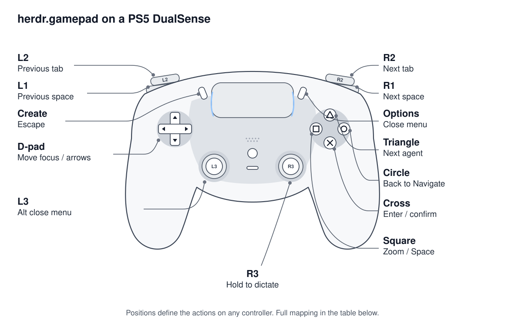

# herdr.gamepad

Drive [Herdr](https://herdr.dev) from a game controller: move between panes, tabs and
spaces, answer agents, drive ordinary panes such as the PR tracker, close panes, and
dictate prompts. Speech is transcribed locally with whisper.cpp.



Actions follow button positions: Xbox A, B, X and Y behave like Cross, Circle, Square and
Triangle. Tested by hand on a DualSense; other controllers are untested.

## Install

Requirements:

- macOS and Herdr 0.9.1 or later.
- Git. A Rust toolchain (`cargo`) and the Xcode Command Line Tools are needed when no
  verified prebuilt binary matches your Mac and source checkout.
- `whisper-cli` from Homebrew's `whisper-cpp` package.
- A controller paired with macOS and microphone permission for the terminal app.

Herdr runs the build script during installation. New releases will include binaries for
Apple Silicon and Intel Macs. The installer verifies the archive's SHA-256 and its embedded
source commit against a clean Git checkout before using a binary. A different commit,
local changes, missing Git metadata, or unavailable/unverifiable assets trigger a source
build with the committed Cargo.lock. Set `HERD_GAMEPAD_BUILD=source` to compile regardless.

Releases through v0.2.0 predate prebuilt assets and require Rust and the Xcode Command
Line Tools.

```sh
brew install whisper-cpp
herdr plugin install PatrickPriestley/herdr-gamepad --ref v0.2.0
```

1. Pair the controller in System Settings > Bluetooth (DualSense: hold Create + PS).
2. Run "Gamepad: set up voice" from the command palette. It downloads the speech model
   (see [Speech model](#speech-model)).
3. Run "Gamepad: start". Allow microphone access for your terminal app when macOS asks.

## Modes

- **Navigate** (default): D-pad moves between panes, L1/R1 between spaces, L2/R2 between
  tabs. Triangle jumps to the next agent that needs you; Square zooms the pane. Cross enters
  Respond on an agent pane or Interact on any other pane.
- **Respond**: keys go to the agent. D-pad moves through options, Cross is Enter, Create is
  Escape, Circle returns to Navigate. Pressing Cross on an agent that is already waiting
  answers it in one press.
- **Interact**: keys go to a non-agent pane. D-pad sends arrows, Cross Enter, Square Space,
  Create Escape, Circle returns to Navigate. In the PR tracker, left/right pick a category
  and Square opens details.

In Respond and Interact, the shoulders, triggers and Triangle act as in Navigate and return
there. Moving focus to another pane also returns to Navigate without sending a key.

**Dictate**: hold R3, speak, release. The text is submitted to the agent you were focused
on; it is dropped if focus moved, the pane has no agent, or the agent is at a dialog.

**Actions**: Options opens a popup with spaces, worktrees, pane actions, close controls,
settings, logs and controls. D-pad selects rows and Cross activates. Close actions name the
captured target and require a separate confirmation. Circle goes back; Create or Options closes.

Routine status goes to the log ("Gamepad: show logs"); only errors appear as notifications.
"Gamepad: show the mapping" shows the full card. "Gamepad: stop" stops listening.

## Buttons

| Position | Xbox | PlayStation | Navigate | Respond | Interact | Actions menu |
|---|---|---|---|---|---|---|
| Bottom face | A | Cross | Respond / Interact | Enter | Enter | Activate |
| Right face | B | Circle | | To Navigate | To Navigate | Back |
| Left face | X | Square | Zoom | Zoom, to Navigate | Space | Details / delete text |
| Top face | Y | Triangle | Next agent | Same, to Navigate | Same, to Navigate | Text character page |
| D-pad | | | Focus pane | Arrows | Arrows | Select / navigate |
| Shoulders | LB / RB | L1 / R1 | Prev / next space | Same, to Navigate | Same, to Navigate | |
| Triggers | LT / RT | L2 / R2 | Prev / next tab | Same, to Navigate | Same, to Navigate | |
| Back | View | Create | | Escape | Escape | Close |
| Menu | Menu | Options | Actions menu | Actions menu | Actions menu | Close |
| Right stick | | R3 | Hold to dictate | Hold to dictate | Hold to dictate | |

If the voice button is set to Options, L3 opens the actions menu.

## Controller actions menu

Press Options/Menu to open actions (L3 when Menu is your voice button). D-pad selects
rows, Right opens a submenu, Cross/A activates, and Circle/B or Left goes back.
Options/Menu or View closes the popup. Finish dictation before opening it.

The menu offers new spaces, worktree creation/open/removal, pane splitting, zoom,
rename, explicit close confirmations, settings, logs and controls. Text entry uses
an on-screen character grid: Cross/A inserts, Square/X deletes, Triangle/Y changes
pages, and Done accepts. Square/X expands long target details outside text entry.

Actions capture the focused pane, tab and workspace. Focus changes dismiss the
menu. A worker checks the captured identity again before mutation. Creation uses
`--no-focus`; switching afterward requires the originating session to remain
interested and its captured focus to still match. Pane splitting uses Herdr's
intrinsic `--focus` behavior. Worktree removal never supplies force or trust flags;
dirty checkouts remain protected by Herdr.

Only one mutation runs at a time, including after the popup closes. A timeout or
lost response leaves its outcome unknown and blocks another mutation. The daemon
may confirm that an exact close target is absent through a read-only refresh;
creation, toggle and other inconclusive results remain blocked and are logged.
Concrete missing-target and protected-worktree refusals release the operation slot.
Generic creation failures remain unknown because partial Git side effects cannot be
ruled out. Do not retry an unknown operation without inspecting Herdr state.

Settings support `[ui] labels = "both"` (default), `"playstation"`, or `"xbox"`,
plus the existing voice button and recording duration. Save preserves unrelated
TOML and comments, checks the original contents, and atomically replaces the file.
Cooperative writers use a lock; editors that ignore it can still race the final
comparison and rename. Conflicts reload the file and discard the stale draft.
Symlinked config files are left intact; edit their target directly instead of using menu Save.
Saved controls apply together when the menu exits; unsaved edits are discarded.
The popup shows labels for the controls currently active until that exit.

After a structural action closes the popup, reopen Actions to see the last result,
including the actual server-selected checkout path. That result is informational;
opening the menu does not repeat the action. Branch suggestions include a timestamp.

## Settings

`$(herdr plugin config-dir herd.gamepad)/config.toml`:

```toml
[whisper]
model = ""          # empty: the downloaded base.en model
language = "en"

[voice]
button = "rstick"   # rstick, lstick or menu
max_seconds = 60

[ui]
labels = "both"    # both, playstation or xbox
```

### Speech model

Setup downloads `ggml-base.en.bin` (148 MB, English) from the
[whisper.cpp model repository](https://huggingface.co/ggerganov/whisper.cpp) into the
plugin's state folder, unless a model is already there. Start refuses to run without one.

To use another model, download it and set `model` to its path. Larger models (`small`,
`medium`) are more accurate and slower; for other languages use a model without `.en` and
set `language`.

## Updating and removing

Run "Gamepad: stop", reinstall with the new `--ref`, then "Gamepad: start".
To remove: stop, then `herdr plugin uninstall herd.gamepad`.

## Development

```sh
cargo test --locked
./install.sh        # build and link a local copy
```

Design notes are in `docs/plans/`. CI builds and tests on Apple silicon and Intel;
controller and microphone behaviour need real hardware.

## Releasing

Releases publish automatically after a stable version tag passes both macOS CI jobs.
The jobs package Apple Silicon and Intel binaries with their tested commit metadata and
SHA-256 checksums. The release includes both archives and checksums. Releases through
v0.2.0 remain source-built; their tags and assets are not rewritten.

Merge a PR that bumps the version in `Cargo.toml`, `Cargo.lock` and `herdr-plugin.toml` and
updates `CHANGELOG.md`, then tag `main`:

```sh
git switch main && git pull --ff-only
git tag -a v0.2.1 -m "Release v0.2.1" && git push origin v0.2.1
```

CI checks the tag matches the versions and publishes the release once both macOS jobs
pass. Never move a published tag; fix mistakes with a new one.

## License

MIT; see [LICENSE](LICENSE).
